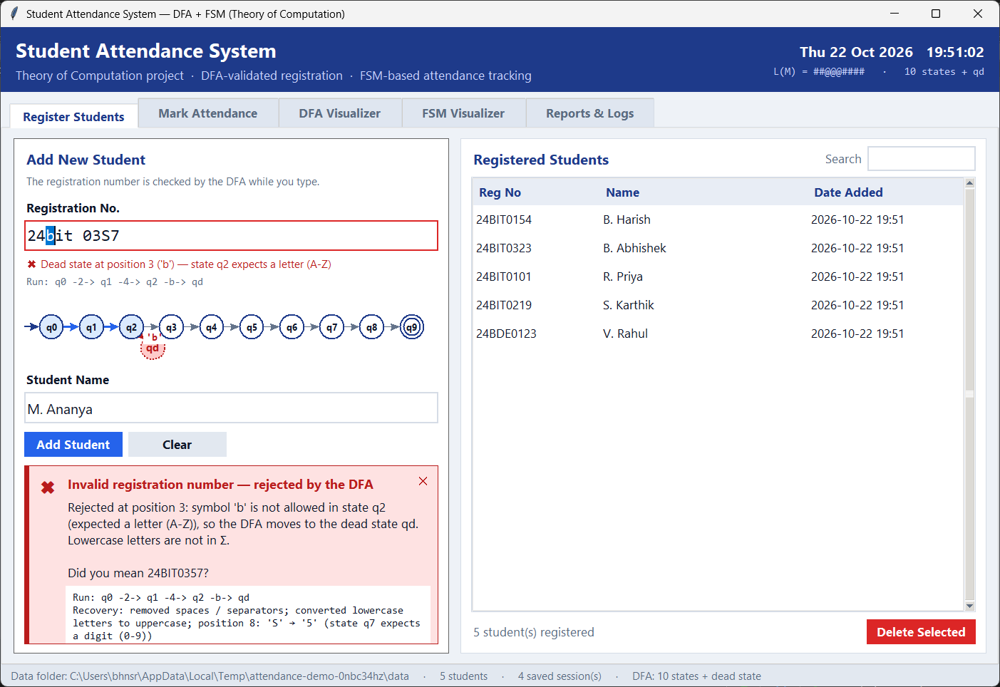

# Student Attendance System — DFA + FSM

Theory of Computation project, VIT. A desktop attendance system in which
**every registration number is checked by a Deterministic Finite Automaton (DFA)**
and **every student's attendance is a Finite State Machine (FSM)** driven by a timer.

| Team member | Reg. No. |
|---|---|
| B. Harish | 24BIT0154 |
| B. Abhishek | 24BIT0323 |



## Highlights

- **DFA validation as you type.** The entry box and a mini state diagram show the current
  state (q0 … q9), the dead state qd, or acceptance after every key press.
- **Exact error messages.** For example: *"Rejected at position 3: symbol 'b' is not allowed
  in state q2 (expected a letter A-Z)"*.
- **"Did you mean …?" recovery.** Typing `24bit 03S7` is corrected to `24BIT0357`. The fix
  removes separators, uppercases letters and swaps look-alikes (O→0, S→5, 1→I), but only
  where the DFA says the swap is legal.
- **Many ID formats, no code change.** Patterns like `24BIT####, 24BDE####` are combined into
  one DFA with the subset construction and then minimised (24 → 13 states).
- **Strict attendance FSM.** States: NOT_MARKED → PRESENT / LATE / ABSENT / EXCUSED / ON_DUTY.
  An undefined δ(state, event), such as marking twice, is rejected and logged. This blocks
  proxy and double marking.
- **Timer & control.** In the on-time window a mark fires MARK_ON_TIME. After the cut-off it
  fires MARK_LATE. When the window ends, TIMEOUT moves everyone unmarked to ABSENT.
- **Crash recovery.** If the app closes during a session, the next start offers to
  restore it with no marks lost.
- **Corrupted-data recovery.** Broken CSV rows are quarantined to a backup file and the
  app keeps working.
- **Visualizers.** An animated DFA run on an input tape (Run / Step), plus an FSM diagram
  that highlights the student's current state and last transition.
- **75 % rule analytics.** Shows each student's attendance % and how many classes in a row
  they need to get back to 75 %. Exports to Excel, or to CSV if openpyxl is missing.
- **Audit trail.** Every rejected input and every FSM transition is written to CSV.

## What makes it different

| A typical attendance system | This project |
|---|---|
| One fixed ID format, checked with if/else or a regex | DFA compiled from patterns; several formats combined with the subset construction + Moore minimisation |
| A generic "invalid ID" message | Position, state, expected symbol and DFA path, plus an automatic correction suggestion |
| No feedback until you press Submit | Live DFA state while typing, with a mini state diagram |
| Status is just written to a file; the same student can be marked twice | A strict FSM per student: undefined δ(state, event) is rejected and logged, which stops double marking |
| Fixed cut-off, or decided by hand | Timer phases (ON_TIME / LATE) and automatic TIMEOUT |
| Errors are hidden, or the app stops | Crash recovery, corrupted-CSV recovery, atomic file writes |
| A raw attendance list | 75 % analytics, Excel export with CSV fallback, audit and reject logs |
| Manual testing | 67 automated tests |

## Theory of Computation concepts used

- **Regular language & DFA:** M = (Q, Σ, δ, q0, F), with Σ = {0-9, A-Z}, a dead (trap) state
  and live states.
- **NFA → DFA (subset construction):** the union of several ID patterns.
- **DFA minimisation (Moore's partition refinement):** equivalent states are merged.
- **Finite State Machine:** a partial transition function δ : S × E → S, where events come
  from the timer and the faculty.
- **Error recovery:** phrase-level correction, an idea borrowed from compiler design.

## Project structure

```
attendance/
  dfa.py         Module 1  DFA: pattern compiler, subset construction, minimisation, trace, suggestions
  storage.py     Module 2  CSV database, quarantine of bad rows, snapshots, logs
  fsm.py         Module 3  Attendance FSM (states, events, transition table)
  gui/           Module 4  Tkinter GUI (app.py, diagrams.py, widgets.py, theme.py)
  session.py     Module 5  Timer & control (on-time / late / timeout, crash snapshot)
  analytics.py   Module 6  75 % rule summary
  exporter.py    Module 7  Excel export with CSV fallback
tests/           67 pytest tests
tools/           capture_screenshots.py (regenerates docs/screenshots)
docs/            report and screenshots
main.py          start the app
```

## Run it

Requires Python 3.10+ (Tkinter is included with Python on Windows).

```bash
pip install -r requirements.txt
python main.py
```

Data is stored in `./data` (created on first run). Use `python main.py --data-dir demo` to keep
a separate demo folder.

Run the tests:

```bash
python -m pytest -q
```

## Error handling & recovery (demo checklist)

| Error | What the system does |
|---|---|
| Invalid reg. no. (`24bit 03S7`, `444`) | DFA rejects it with position, state and expected symbol, then offers a correction |
| Duplicate registration | Blocked; the existing record is highlighted |
| Invalid name (`Rahul99`) | Rejected with the offending character |
| Marking with no session | Error with a **Start session now** button |
| Unregistered student | Error with a **Register this student** button |
| Double marking | FSM rejects δ(PRESENT, MARK_ON_TIME) and logs it |
| Session time-out | TIMEOUT moves every unmarked student to ABSENT automatically |
| Bad ID pattern (`24BIT##?#`) | Pattern rejected; the previous DFA stays active |
| Damaged CSV file | Bad rows are moved to a quarantine file; good rows load |
| App crash mid-session | Snapshot is restored on the next start, with no marks lost |
| Excel export without openpyxl | Falls back to CSV files |

More screenshots are in [docs/screenshots](docs/screenshots).

The project report is in [docs/report](docs/report/TOC_Final_Report_Student_Attendance_System.pdf),
available as PDF and Word.

## References (base papers in bold)

1. **M. O. Rabin and D. Scott, "Finite Automata and Their Decision Problems," *IBM Journal of
   Research and Development*, vol. 3, no. 2, pp. 114–125, 1959.** Base paper for the DFA,
   NFA and subset construction.
2. **E. F. Moore, "Gedanken-Experiments on Sequential Machines," in *Automata Studies*,
   Princeton University Press, 1956, pp. 129–153.** Base paper for state machines and
   state equivalence (minimisation).
3. J. E. Hopcroft, R. Motwani and J. D. Ullman, *Introduction to Automata Theory, Languages,
   and Computation*, 3rd ed., Pearson, 2006.
4. M. Sipser, *Introduction to the Theory of Computation*, 3rd ed., Cengage Learning, 2013.
5. A. V. Aho, M. S. Lam, R. Sethi and J. D. Ullman, *Compilers: Principles, Techniques, and
   Tools*, 2nd ed., Pearson, 2006. Chapter on error recovery.
6. Python documentation: tkinter (https://docs.python.org/3/library/tkinter.html) and
   csv (https://docs.python.org/3/library/csv.html).
7. openpyxl documentation, https://openpyxl.readthedocs.io/
8. **Base link:** reference implementation of a DFA/FSM attendance system,
   https://github.com/hanumasathvik75/STUDENT-ATTENDENCE-SYSTEM
